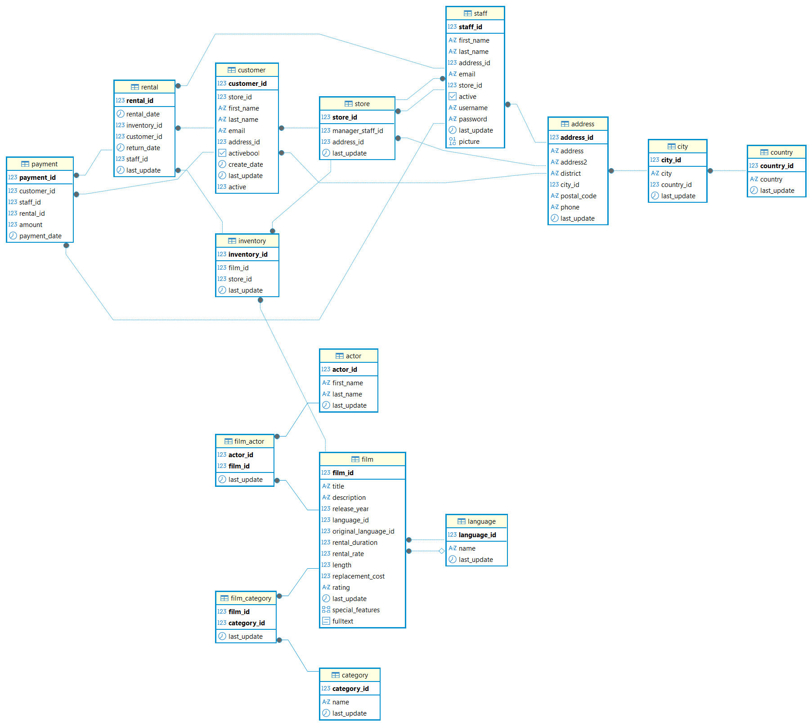
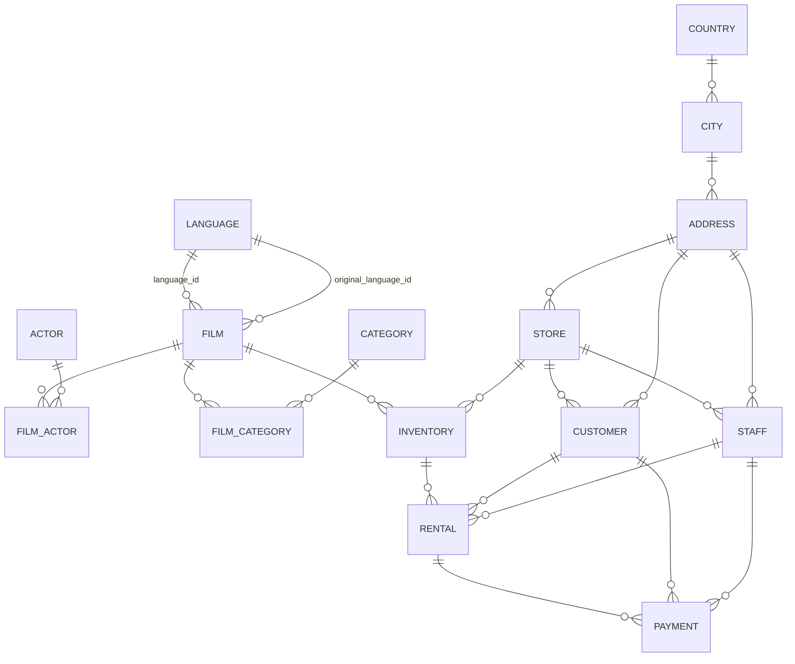

# DataProject: Lógica y Consultas SQL

Proyecto de consultas SQL sobre una base de datos de alquiler de películas (tipo Sakila), trabajado con **PostgreSQL** y **DBeaver**.

## Contenido del repositorio

| Archivo / carpeta | Descripción |
|---|---|
| `README.md` | Pasos seguidos durante el proyecto e informe de análisis |
| `DataProject_LogicaConsultasSQL.sql` | Las 64 consultas resueltas, cada una con su número y enunciado como comentario |
| `BBDD_Proyecto_shakila_sinuser.sql` | Script de creación y carga de la base de datos proporcionado |
| `esquema_bbdd.png` | Diagrama ER de la base de datos generado con DBeaver |

## Herramientas

- PostgreSQL
- DBeaver 26.1

## Pasos seguidos

1. **Conexión:** creación de una conexión PostgreSQL en DBeaver (`localhost:5432`) con la opción *Show all databases* activada.
2. **Creación de la base de datos:** `bbdd_proyect`, con codificación UTF8.
3. **Carga del esquema y los datos:** ejecución del script `BBDD_Proyecto_shakila_sinuser.sql` sobre `bbdd_proyect`.
4. **Verificación de la carga:** recuento de filas de las tablas principales (ver tabla de abajo).
5. **Análisis de la base de datos:** revisión de tablas, claves y relaciones, y generación del diagrama ER.
6. **Resolución de las consultas:** ejecución de las 64 consultas una a una, comprobando que cada resultado tuviera sentido.
7. **Objetos adicionales:** creación de una vista (consulta 48) y de dos tablas temporales (consultas 51 y 52).

## Esquema de la base de datos

La base de datos tiene **15 tablas** en el esquema `public`.

| Tabla | Filas | Descripción |
|---|---:|---|
| `language` | 6 | Idiomas |
| `country` | 109 | Países |
| `city` | 600 | Ciudades |
| `address` | 603 | Direcciones |
| `actor` | 200 | Actores |
| `staff` | 2 | Empleados |
| `store` | 2 | Tiendas |
| `category` | 16 | Categorías de películas |
| `film` | 1000 | Películas |
| `inventory` | 4581 | Copias de películas por tienda |
| `film_actor` | 5462 | Relación N:M película–actor |
| `film_category` | 1000 | Relación película–categoría |
| `customer` | 599 | Clientes |
| `rental` | 16044 | Alquileres |
| `payment` | 16049 | Pagos |

### Diagrama de relaciones

## Informe de análisis

### Comprensión de los datos

- **Películas:** las 1000 películas son de 2006. Su reparto por clasificación es PG-13 (223), NC-17 (210), R (195), PG (194) y G (178).
- **Texto en mayúsculas:** los títulos de películas y los nombres de actores y clientes están guardados en mayúsculas (por ejemplo, `EGG IGBY`). Por eso las búsquedas por texto usan `UPPER()` o `ILIKE`.
- **Idioma original:** `original_language_id` es `NULL` en todas las películas. Por ello la consulta 4 (idioma igual al idioma original) devuelve 0 filas, y es el resultado correcto.
- **Alquileres sin devolver:** 183 alquileres tienen `return_date` nulo. Se tienen en cuenta en las consultas 29.b y 53.
- **Pagos y alquileres:** hay 16049 pagos frente a 16044 alquileres, es decir, algunos alquileres tienen más de un pago o hay pagos que no se corresponden uno a uno con un alquiler. Conviene tenerlo presente al relacionar `rental` con `payment` (consulta 11).
- **Relaciones N:M:** actor–película (`film_actor`) y película–categoría (`film_category`) se resuelven con tablas intermedias, por lo que las consultas sobre ellas necesitan dos `JOIN`.

### Decisiones de interpretación

| Consulta | Decisión |
|---|---|
| 4 | Devuelve 0 filas por los valores NULL de `original_language_id`. |
| 11 | El importe se obtiene de `payment`; los alquileres se ordenan por `rental_date` descendente y se salta los dos últimos. |
| 21 | Se ofrecen dos versiones: duración prevista (`film.rental_duration`) y duración real (devolución menos alquiler). |
| 26 | Se calcula sobre el importe de cada pago (`payment.amount`). |
| 27 | Se compara el `rental_rate` de cada película con el `rental_rate` medio. |
| 29 | Se ofrecen dos versiones: copias en inventario y copias realmente disponibles (sin alquiler pendiente). |
| 33 | Se usa `FULL JOIN` para conservar películas sin alquileres y alquileres sin película. |
| 44 | El `CROSS JOIN` no aporta valor: produce 16.000 combinaciones sin significado (explicación en el script). |
| 55 | Se buscan actores de películas con algún alquiler posterior al primer alquiler de 'Spartacus Cheaper'. |
| 58 | Se interpreta como las películas de la categoría 'Animation'. |
| 59 | Se excluye la propia película 'Dancing Fever' del resultado. |
| 63 | Aquí el `CROSS JOIN` sí es el correcto, porque se piden todas las combinaciones. |

### Conocimientos demostrados

| Requisito | Consultas |
|---|---|
| Manejo de DBeaver | 1 (conexión, carga del script, diagrama ER) |
| Consultas sobre una sola tabla | 2–10, 12–16, 18, 22, 35–40 |
| Relaciones entre tablas (`JOIN`) | 17, 19, 20, 29–34, 42–47, 49, 50, 53–54, 57, 60–64 |
| Subconsultas | 24, 27, 41, 46, 55, 56, 58, 59 |
| Vistas | 48 |
| Estructuras de datos temporales | 51, 52 (tablas temporales) y 11 (CTE) |

## Cómo reproducir el proyecto

1. Crear la base de datos `bbdd_proyect` en PostgreSQL.
2. Ejecutar `BBDD_Proyecto_shakila_sinuser.sql` sobre esa base de datos.
3. Ejecutar `DataProject_LogicaConsultasSQL.sql`, consulta a consulta (`Ctrl+Intro` en DBeaver). Las consultas 51 y 52 crean tablas temporales que solo existen durante la sesión.
